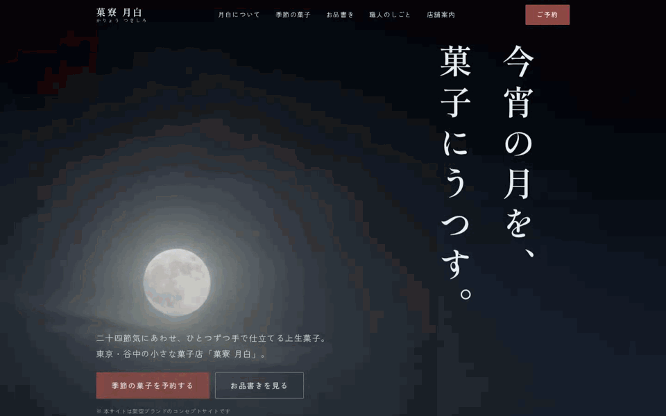
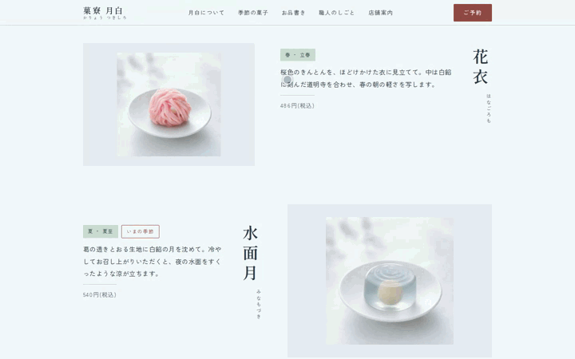
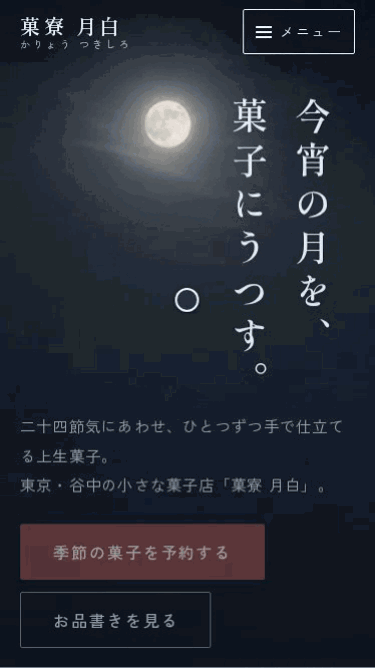

# 菓寮 月白(かりょう つきしろ)

> **Concept Project** — 本サイトはフロントエンド制作の実績提示を目的とした架空ブランドのコンセプトサイトです。「菓寮 月白」は実在せず、掲載している店舗・商品・人物・住所・価格はすべて架空の設定です。フォームからの送信は行われません。

二十四節気にあわせた上生菓子を手仕事で作る、架空の和菓子店のブランドサイト。
React + TypeScript + Vite による1ページ構成のレスポンシブサイトです。


## デザインコンセプト

**「月白」= 月が昇る直前、空が白んで見える色の名。**

この語源をそのままスクロール体験に変換しています。ファーストビューは鉄紺の夜空に月が昇る情景から始まり、スクロールするにつれ空が白み、以降のセクションは月白(#F3F8FA)の淡い地色で展開します。ページを下る行為そのものが「月白」という言葉の追体験になる構成です。

- **配色**: 日本の伝統色から採取(月白・鉄紺・藍墨・小豆・白緑・銀鼠)
- **タイポグラフィ**: 見出しにしっぽり明朝、本文にZen角ゴシックNew。ヒーローの大見出しと菓銘は縦書き(`writing-mode: vertical-rl`)
- **ビジュアル**: 地図・青海波文様などの図版は自作SVG/CSS。ヒーローの月夜・商品・店舗の写真はAI画像生成で制作(プロンプトは `docs/image-prompts.md`)
- **屋号の色見本**: 「月白について」の夜の地に、屋号と同じ色(サイトの地色 `--c-geppaku`)の札を月のように浮かべ、色の名と由来を添える
- **季節の菓子**: いまの季節の一品を大きな写真で主役に据え、残りの三季は、これから巡ってくる順に写真つきの三列に。皿の余白が広い写真は 4:5 に切り出して少し寄り、菓子そのものを大きく見せる
- **今日の暦**: 開いた日の日付から、二十四節気と今宵の月(月齢・月の名・満ち欠けのかたち)を求めて表示する。主役の菓子はこの暦で決まるので、立冬を過ぎれば冬の菓子に、立春を過ぎれば春の菓子に替わる。節気は「ごろ」の日付表、月齢は朔望月の平均で数える目安の計算で、外部のAPIやライブラリは使っていない(`src/features/koyomi/`。実際の新月・満月の日で確かめるテストつき)
- **日本語の改行**: `word-break: auto-phrase` と `text-wrap: pretty` で文節の切れ目で折り返し、一字だけの行を避ける(表のセルは対象外)
- **モーション**: スクロール連動の二段リビール(菓子の画像が先、菓銘と言葉が0.12s遅れて現れる)、商品画像のhover微zoom、ドロワーのスライドイン、青海波のゆらぎ、ヘッダーの透過遷移。durationとeasingはデザイントークン(`--dur-fast/base/slow/reveal` + `--ease-out`)に統一し、`prefers-reduced-motion` で全停止

### 設計根拠(市場調査ベース)

商業サイト12件の市場調査から抽出した設計原則(高級商材は世界観と質感で信頼を作る/CTAは理解が最高潮の直後に置く/AI生成に見える表現を避ける、など)をもとに設計しています。原則と実装の対応は [docs/design-rationale.md](docs/design-rationale.md) を参照してください。

## 主な機能

- 固定ヘッダー(ヒーロー上では透過、スクロールで月白地に遷移)
- モバイルドロワーナビゲーション(フォーカストラップ・Escapeで閉じる・背面スクロールロック)
- 季節の菓子コレクション(ジグザグレイアウト+縦書き菓銘)
- 品書きらしい点線リーダー付きのお品書き
- 予約フォーム(フロントエンドバリデーション)
  - ひらがな検証、電話番号・メール形式、受取日は「3日後〜60日先・水曜定休不可」
  - blur時+送信時の検証、エラーサマリーからの各項目リンク、`aria-invalid` / `aria-describedby`
- スキップリンク、セマンティックHTML、キーボード操作対応

## 技術構成

| 領域 | 採用技術 |
|---|---|
| フレームワーク | React 19 + TypeScript(strict) |
| ビルド | Vite 8 |
| スタイル | CSS Modules + CSS Custom Properties(デザイントークン) |
| フォント | @fontsource(セルフホスト・unicode-rangeスライス配信) |
| テスト | Vitest + Testing Library(68件) |
| lint | oxlint |

アニメーションライブラリ・CSSフレームワークは使用していません(依存は最小限)。動きはすべて素の CSS(opacity / translate / scale)で実装しています。

## セットアップ

```bash
npm install
npm run dev        # http://localhost:5173
```

## 開発コマンド

```bash
npm run lint       # oxlint
npm run typecheck  # tsc -b(TypeScript strict)
npm run test       # vitest(バリデーション・フォーム・ドロワー・スモーク)
npm run build      # 型チェック + production build(dist/)
npm run test:a11y  # axe-coreによるアクセシビリティ検査(要build)
npm run preview    # production buildの確認
```

## レスポンシブ対応

360 / 375 / 768 / 1024 / 1440px で表示確認済み(横スクロールなしを機械検査)。
モバイルはデスクトップの縮小ではなく、縦書き見出しの位置・コレクションの並び・ナビゲーションを別レイアウトで設計しています。

## アクセシビリティ

- ランドマークと `aria-labelledby` によるセクション構造、h1〜h3の正しい階層
- スキップリンク、`:focus-visible` のフォーカスリング(夜色背景では明色に切替)
- ドロワーのフォーカストラップとフォーカス返却
- 装飾SVGは `aria-hidden`、意味のあるSVGは `role="img"` + 説明
- 本文コントラスト4.5:1以上、タップ領域44px以上
- `prefers-reduced-motion: reduce` でアニメーション・smooth scrollを無効化
- **axe-core による自動検査をCIで実行**(デスクトップ・ドロワー開・フォームエラー表示の3状態。violationが1件でもあればデプロイを中止)

## Lighthouse スコア

production build(`npm run preview`)に対する Lighthouse 12 のローカル計測結果:

| カテゴリ | Mobile | Desktop |
|---|---|---|
| Performance | **98** | **100** |
| Accessibility | **100** | **100** |
| Best Practices | **100** | **100** |
| SEO | **100** | **100** |

当初 Performance は mobile 46 / desktop 65 でした。原因を分析し、3つの改善で引き上げています:

- **LCPの即時確定**: LCP要素であるヒーロー見出しのアニメーションから opacity を外し、上昇(translate)のみに変更(LCP: mobile 11.2s → 1.8s)
- **srcset対応**: 商品画像に 320/480/720w の3段バリアントを用意し、表示幅とDPRに見合う一枚だけを配信
- **インライン化の抑止**: `assetsInlineLimit: 0` で、フォントスライスや小画像がCSS/JSにbase64埋め込みされるのを防止(CSS転送 −45%)。unicode-range・srcset の「必要な分だけ取得する」設計とインライン化は両立しないため

※ ローカル(WSL2)でのシミュレーテッドスロットリング計測。mobileは複数回計測で安定を確認。

## デプロイ

`main` ブランチへのpushで、GitHub Actions(`.github/workflows/deploy.yml`)がlint・テスト・buildを実行し、GitHub Pagesへ自動デプロイします。

- ライブデモ: https://niwatory11.github.io/kario-tsukishiro/
- サブパス配信のため `vite.config.ts` で `base: '/kario-tsukishiro/'` を設定済み(リポジトリ名を変えた場合はここも変更)

他の静的ホスティング(Netlify / Vercel等)へは `npm run build` の `dist/` をそのまま配置できます(その場合 `base` を `'/'` に戻してください)。

> 補足: 日本語フォントをセルフホストしているため `dist/` のファイル数は多めですが、unicode-rangeスライスにより実際の転送は使用グリフ分のみです。

## アニメーションデモ

動きはすべて素のCSS(opacity / translate / scale)+モーショントークンで実装しています(仕様は [docs/animation-spec.md](docs/animation-spec.md))。

**二段リビール** — スクロールで菓子の画像が先に、菓銘と言葉が一拍遅れて現れます。



**商品画像のhover微zoom** — カーソルを重ねると写真がゆっくり寄ります(scale 1.03)。



**モバイルドロワー** — スライドインで開き、フォーカストラップ・Escapeで閉じる操作に対応。



## スクリーンショット

`docs/screenshots/` に各画面幅のキャプチャを置いています。

## ライセンス・注意

個人ポートフォリオ用のコンセプト作品です。文章・SVGイラストを含む全アセットは本リポジトリのために制作したものです。写真画像はAI画像生成(ChatGPT / DALL-E系)で本サイト用に生成したもので、実在の店舗・商品を写したものではありません。
