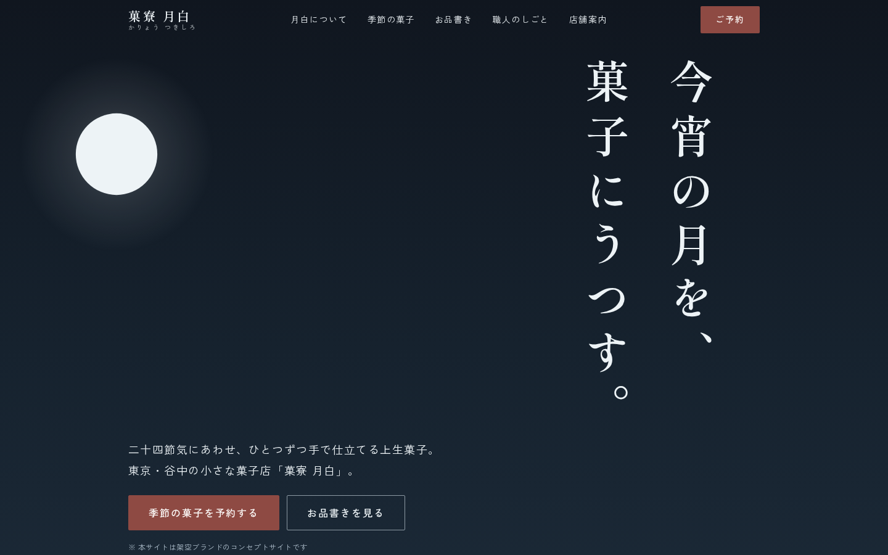

# 菓寮 月白(かりょう つきしろ)

> **Concept Project** — 本サイトはフロントエンド制作の実績提示を目的とした架空ブランドのコンセプトサイトです。「菓寮 月白」は実在せず、掲載している店舗・商品・人物・住所・価格はすべて架空の設定です。フォームからの送信は行われません。

二十四節気にあわせた上生菓子を手仕事で作る、架空の和菓子店のブランドサイト。
React + TypeScript + Vite による1ページ構成のレスポンシブサイトです。



## デザインコンセプト

**「月白」= 月が昇る直前、空が白んで見える色の名。**

この語源をそのままスクロール体験に変換しています。ファーストビューは鉄紺の夜空に月が昇る情景から始まり、スクロールするにつれ空が白み、以降のセクションは月白(#F3F8FA)の淡い地色で展開します。ページを下る行為そのものが「月白」という言葉の追体験になる構成です。

- **配色**: 日本の伝統色から採取(月白・鉄紺・藍墨・小豆・白緑・銀鼠)
- **タイポグラフィ**: 見出しにしっぽり明朝、本文にZen角ゴシックNew。ヒーローの大見出しと菓銘は縦書き(`writing-mode: vertical-rl`)
- **ビジュアル**: 写真を一切使わず、和菓子・地図・青海波文様などすべて自作SVG/CSSで描画
- **モーション**: IntersectionObserverによる控えめなフェードイン、青海波のゆらぎ、ヘッダーの透過遷移のみ。`prefers-reduced-motion` で全停止

### 設計根拠(市場調査ベース)

商業サイト12件の市場調査から抽出した設計原則(高級商材は世界観と質感で信頼を作る/CTAは理解が最高潮の直後に置く/AI生成に見える表現を避ける、など)をもとに設計しています。原則と実装の対応は [docs/design-rationale.md](docs/design-rationale.md) を参照してください。

## 主な機能

- 固定ヘッダー(ヒーロー上では透過、スクロールで月白地に遷移)
- モバイルドロワーナビゲーション(フォーカストラップ・Escapeで閉じる・背面スクロールロック)
- 季節の菓子コレクション(ジグザグレイアウト+縦書き菓銘)
- 品書きらしい点線リーダー付きのお品書き
- 予約フォーム(フロントエンドバリデーション)
  - ひらがな検証、電話番号・メール形式、受取日は「3日後〜60日先・水曜定休不可」
  - blur時+送信時の検証、エラーサマリーからの各項目リンク、`aria-invalid` / `aria-describedby`
- スキップリンク、セマンティックHTML、キーボード操作対応

## 技術構成

| 領域 | 採用技術 |
|---|---|
| フレームワーク | React 19 + TypeScript(strict) |
| ビルド | Vite 8 |
| スタイル | CSS Modules + CSS Custom Properties(デザイントークン) |
| フォント | @fontsource(セルフホスト・unicode-rangeスライス配信) |
| テスト | Vitest + Testing Library(40件) |
| lint | oxlint |

アニメーションライブラリ・CSSフレームワークは使用していません(依存は最小限)。

## セットアップ

```bash
npm install
npm run dev        # http://localhost:5173
```

## 開発コマンド

```bash
npm run lint       # oxlint
npm run typecheck  # tsc -b(TypeScript strict)
npm run test       # vitest(バリデーション・フォーム・ドロワー・スモーク)
npm run build      # 型チェック + production build(dist/)
npm run preview    # production buildの確認
```

## レスポンシブ対応

360 / 375 / 768 / 1024 / 1440px で表示確認済み(横スクロールなしを機械検査)。
モバイルはデスクトップの縮小ではなく、縦書き見出しの位置・コレクションの並び・ナビゲーションを別レイアウトで設計しています。

## アクセシビリティ

- ランドマークと `aria-labelledby` によるセクション構造、h1〜h3の正しい階層
- スキップリンク、`:focus-visible` のフォーカスリング(夜色背景では明色に切替)
- ドロワーのフォーカストラップとフォーカス返却
- 装飾SVGは `aria-hidden`、意味のあるSVGは `role="img"` + 説明
- 本文コントラスト4.5:1以上、タップ領域44px以上
- `prefers-reduced-motion: reduce` でアニメーション・smooth scrollを無効化

## デプロイ

`main` ブランチへのpushで、GitHub Actions(`.github/workflows/deploy.yml`)がlint・テスト・buildを実行し、GitHub Pagesへ自動デプロイします。

- ライブデモ: https://niwatory11.github.io/kario-tsukishiro/
- サブパス配信のため `vite.config.ts` で `base: '/kario-tsukishiro/'` を設定済み(リポジトリ名を変えた場合はここも変更)

他の静的ホスティング(Netlify / Vercel等)へは `npm run build` の `dist/` をそのまま配置できます(その場合 `base` を `'/'` に戻してください)。

> 補足: 日本語フォントをセルフホストしているため `dist/` のファイル数は多めですが、unicode-rangeスライスにより実際の転送は使用グリフ分のみです。

## スクリーンショット

`docs/screenshots/` に各画面幅のキャプチャを置いています。

## ライセンス・注意

個人ポートフォリオ用のコンセプト作品です。文章・SVGイラストを含む全アセットは本リポジトリのために制作したものです。
